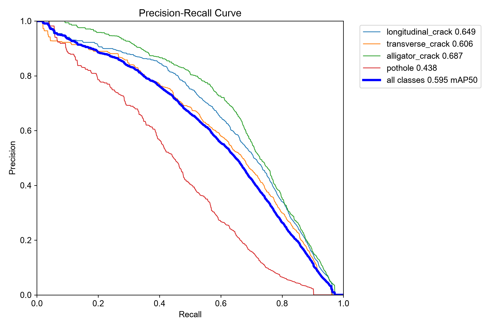

# Road & Surface Defect Detection (YOLO11 · RDD2022)

End-to-end road-damage detector: dataset preparation, YOLO11 training on RDD2022,
evaluation (mAP@0.5, per-class, per-country), severity scoring, and a Dockerised FastAPI
service deployed on Render.

**Live API:** https://road-damage-detection-le7h.onrender.com  ·  docs: `/docs`  ·  metrics: `/metrics`
(free tier — first request after 15 min idle takes ~1 min to wake)

## Results

Validation split: 4,530 images / 6,516 defects (15% held out per country). YOLO11n, 640 px, 25 epochs
(about 11.5 h of training on an Apple M4). Evaluated with conf 0.001, NMS IoU 0.6 (`scripts/evaluate.py`).

**mAP@0.5 = 0.595 · mAP@0.5:0.95 = 0.296**

| Class | Precision | Recall | mAP@0.5 | mAP@0.5:0.95 |
|---|---|---|---|---|
| longitudinal_crack | 0.600 | 0.636 | 0.649 | 0.354 |
| transverse_crack | 0.577 | 0.606 | 0.607 | 0.286 |
| alligator_crack | 0.706 | 0.618 | 0.687 | 0.358 |
| pothole | 0.612 | 0.375 | 0.438 | 0.185 |
| **all** | **0.624** | **0.558** | **0.595** | **0.296** |

| Country | Val images | mAP@0.5 | mAP@0.5:0.95 |
|---|---|---|---|
| China_Drone | 360 | 0.621 | 0.319 |
| China_MotorBike | 296 | 0.858 | 0.488 |
| Czech | 424 | 0.396 | 0.153 |
| India | 1155 | 0.349 | 0.153 |
| Japan | 1575 | 0.523 | 0.238 |
| United_States | 720 | 0.564 | 0.317 |

Potholes are the weakest class: mostly a recall problem (0.375), as they are the rarest class
(959 val instances) and many are small or far away. Czech and India score lowest by country.
The China_MotorBike split is easiest. Full metrics are in `results/metrics.json`, and plots
(PR curve, confusion matrix, training curves) are in `results/plots/`.



## Pipeline

| Step | Script |
|---|---|
| Download 6 RDD2022 countries via HTTP range requests (Norway skipped, 10.6 GB) | `scripts/download_rdd.py` |
| Pascal-VOC → YOLO, keep D00/D10/D20/D40, seeded 85/15 split per country | `scripts/convert_to_yolo.py` |
| Train YOLO11n, 640px, 25 epochs, Apple MPS | `scripts/train.py`, `scripts/resume.py` |
| Evaluate overall / per-class / per-country | `scripts/evaluate.py` |
| Serve: ONNX Runtime + FastAPI + severity scoring | `app/` |

Dataset: 25,694 train / 4,530 val images; 37,261 / 6,516 labelled defects.

## Severity scoring

See [`app/severity.py`](app/severity.py) and [`app/README.md`](app/README.md).

## Reproduce

```bash
python3.11 -m venv .venv && .venv/bin/pip install ultralytics remotezip onnx onnxruntime onnxslim
.venv/bin/python scripts/download_rdd.py data/raw
.venv/bin/python scripts/convert_to_yolo.py data/raw data/rdd2022_yolo
.venv/bin/python scripts/train.py yolo11n.pt 25 rdd_yolo11n
.venv/bin/python scripts/evaluate.py runs/detect/runs/rdd_yolo11n/weights/best.pt
```

Run the API: `cd app && docker build -t road-damage . && docker run -p 7860:7860 road-damage`

Dataset © Arya et al., RDD2022, CC BY-SA 4.0.
